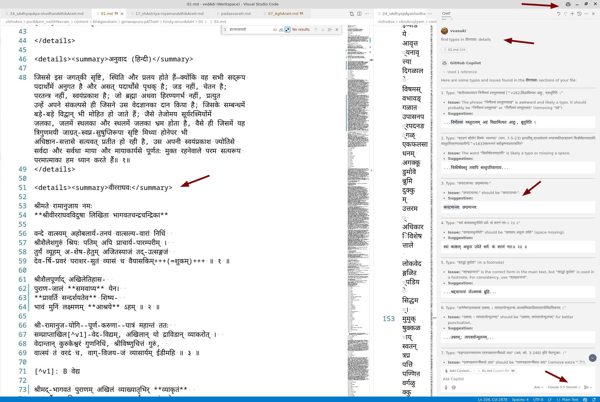

+++
title = "AI help"
+++
You can take the help of AI for proofreading. 

## Correcting AI/ LLM text
यान्त्रिकशोधनम् पूर्वम् एवादिमासु बहुषु सञ्चिकासु कृता वर्तते।  
यान्त्रिक-दोष-परिष्कारश् च तत्रैवं दृश्यते [[कोविदारं करञ्ज च श्लेष्मातकविभीतकौ | कोविदारं करञ्जं च श्लेष्मातक-विभीतकौ]][[OLD|NEW]] इति यन्त्रकृता सूचना। तत्र यथोचितं NEW भागो गृहणीयः, परिष्कार्यश् च स्यात्।  
आसु सञ्चिकासु कथं वर्तनीयम् इत्य् अत्रोच्यते।  

[[OLD|NEW]] इति यन्त्र-दर्शित-स्थानेषु सूक्ष्मतरपरीक्षणम्।  
अन्यत्र तु – परीक्षा कुत्र कियत् सूक्ष्मं स्यात्,  
कुत्र कियत् स्थूलं स्यात् (स्थाली-पुलक-न्यायः कियान् प्रयोक्तव्यः) इति स्वतो निश्चिनोतु।  
अत्यन्तशुद्धिर् इष्टा पाठे, सिद्धौ वेगश् चापि।

आहत्य किं साधु किम् असाधु कृतम् इति परामर्शः प्रेषणीयः, यथापेक्षं परिष्कारश् च विधेयः, येन भविष्ये यन्त्र-प्रयोगः कुशलतरस् स्यात्।

Ctrl+H कृत्वा  
`\[\[[^\|]+\|(.+?)\]\]` इति स्थापयित्वा  
चित्रे दर्शितया रीत्या शीघ्रं परिष्कार-स्वीकारश् शक्यः। 

## Web interface
See separate [page](../AI-prompt).

## Inside editor
See images [here](/groups/dyuganga/projects/text/proofreading/images/AI) to get ideas.

You can get this assistance from within the Vscode or Intellij editor.

{title="" class="thumbnail"}

## Use cases
kArttika uses LLMs to go from a pdf scan to formatted text. 8 hours per the entire chandamama issue of 50-60 pages. ("I was spending 40+ hours when it was tesseract-based. So, 2-3 stories a week, max.")

